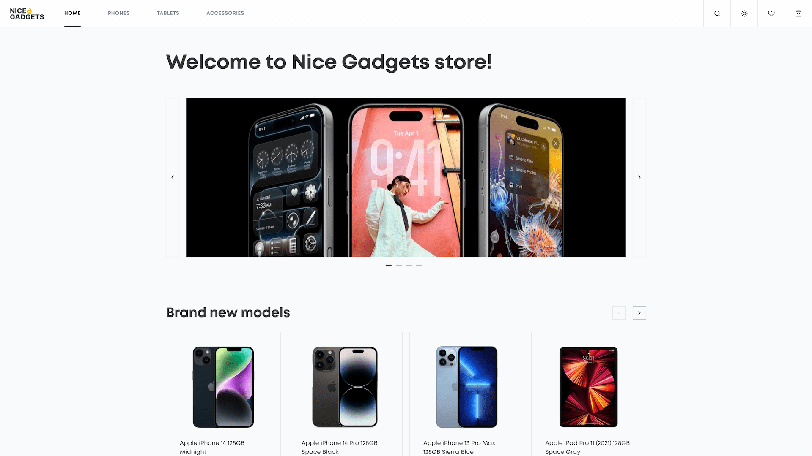

# Nice Gadgets

A responsive e-commerce website for phones, tablets & accessories — browse a catalog,
inspect product details, and manage a persistent cart, favorites, and checkout.

[Live Demo →](https://store-nice-gadgets.netlify.app/)



## Tech Stack

React 19 · TypeScript · Vite 8 · SCSS + BEM · Zustand · React Router 7 · Swiper · Radix UI · Sonner

## Features

- **Product catalog** — browse phones, tablets & accessories with sorting, filtering & pagination
- **Product details** — image gallery, color & capacity pickers, tech specs, and suggested products
- **Cart & checkout** — persistent cart with quantity controls and an order form with delivery options
- **Favorites** — toggle and persist favorite products across sessions
- **Global search** — modal search with debounced results and a `⌘/Ctrl + K` shortcut
- **Theming** — light / dark / auto (system) themes, persisted
- **Polished UX** — loading skeletons, empty & error states, toast notifications, and a 404 page

## Getting Started

```bash
npm install
npm run dev               # opens http://localhost:5173
```

> Requires **Node 22+**

## Scripts

| Script                  | Description                                |
| ----------------------- | ------------------------------------------ |
| `npm run dev` / `start` | Dev server with HMR (opens browser)        |
| `npm run build`         | Type-check (`tsc -b`) then build → `dist/` |
| `npm run preview`       | Preview the production build locally       |
| `npm run typecheck`     | Type-check only (`tsc -b`)                 |
| `npm run lint`          | ESLint + Stylelint                         |
| `npm run lint:fix`      | Auto-fix ESLint + Stylelint                |
| `npm run format`        | Prettier write (`format:check` to verify)  |
| `npm run fix-style`     | `format` + `lint:fix`                      |

## License

MIT © 2026 Artem
